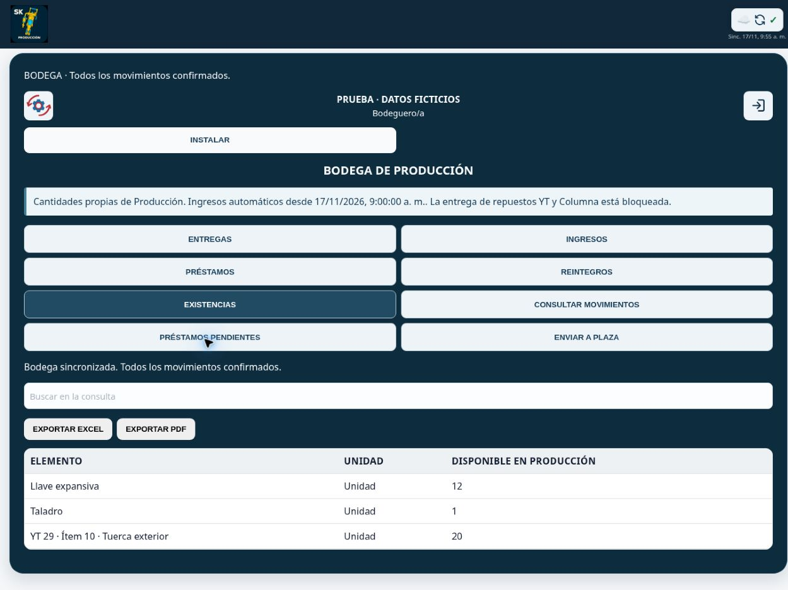
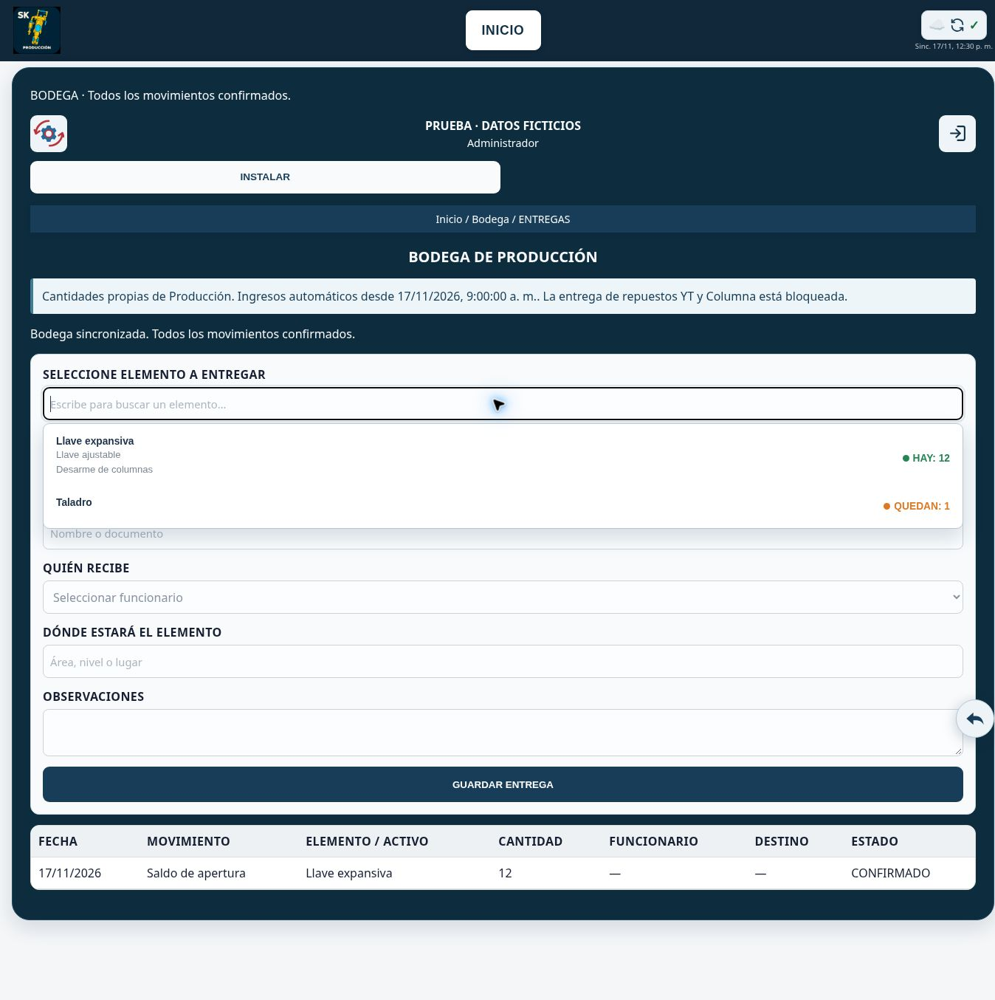

# Bodega de Producción

Producción conserva sus propias cantidades y movimientos en `sk-web-production.json`. Plaza Blending recibe únicamente los traslados que regresan a su bodega. Sus credenciales y su respuesta de sincronización no permiten consultar el libro ni las cantidades de Producción.

## Puesta en marcha

1. En el proyecto de Google Apps Script que actualmente atiende las tres apps, reemplazar `Code.gs` por `backend/apps-script/Code.gs` de esta versión y guardar.
2. En **Implementar → Administrar implementaciones → Editar**, elegir **Nueva versión** y actualizar la implementación existente. Conservar la URL y sus propiedades actuales.
3. Actualizar SK Web Admin, Plaza Blending y Producción con el engranaje de cada app. No borrar sus datos ni descartar pendientes.
4. En SK Web Admin, abrir **USUARIOS DE PRODUCCIÓN → Bodega de Producción → ACTIVAR BODEGA DE PRODUCCIÓN**.
5. Registrar en Producción los saldos de apertura de los elementos por cantidad presentes al momento de activar. Los activos fijos ya ubicados en Bodega de Producción-N. 4 aparecen por su ficha, sin otra apertura ni ingreso. Los repuestos mantienen sus aperturas e inventarios anteriores en Mecánica; no se vuelven a cargar.
6. Asignar **Bodeguero/a**, **Mecánico** o **Mecánico y bodeguero/a** mediante el enlace de acceso del funcionario. La activación del enlace aplica sus roles. Una cuenta de Administrador puede entrar a ambos módulos.

La actualización del repositorio no actualiza automáticamente la implementación de Apps Script. La bodega permanece desactivada hasta el paso 4. La fecha de activación queda registrada: solo se incorporan salidas de Plaza creadas desde ese momento, para no duplicar lo ya incluido en las aperturas. Sincronizar los pendientes de Plaza antes de establecer esa apertura.

## Flujo

- Mecánico: entrada directa a la interfaz de consumos existente, con selección **YT / COLUMNA** en Tipo de equipo.
- Bodeguero: entrada directa a **BODEGA**, con entregas, ingresos externos, préstamos, reintegros, existencias y consultas.
- Ambos roles o Administrador: selección entre **MECÁNICA** y **BODEGA**.
- Plaza: las salidas cuyo destino es Producción se incorporan una sola vez. En elementos ordinarios se elige **DESTINO → Bodega de Producción**; los repuestos conservan su destino automático.
- Los ingresos externos permiten recibir activos registrados o dar de alta uno nuevo, incluidos ingresos para reparación. Se conserva una identidad global para cada activo.
- Los préstamos internos permiten reintegros parciales y consulta de pendientes, devueltos o todos.
- **ENVIAR A PLAZA** descuenta en Producción y registra el ingreso en Plaza. Si corresponde a un préstamo recibido desde Plaza, seleccionarlo: su devolución es completa, conforme al flujo actual de Plaza. Para activos fijos se identifica automáticamente el préstamo importado pendiente del mismo activo.
- Entregas y préstamos de repuestos desde Bodega quedan bloqueados por defecto. El administrador puede habilitarlos en Web Admin. Mecánica y Bodega utilizan las mismas existencias de repuestos; las salidas de Bodega aparecen separadas de los consumos en el conteo físico.

Los botones de Bodega abren sus pantallas aunque falte la activación o haya una sincronización en curso. El registro de movimientos requiere activación y un catálogo descargado; el aviso indica dónde activarla. La sincronización actualiza los selectores sin borrar los datos que se están escribiendo.

## Selector y exclusión de EPP

Bodega utiliza el mismo selector de Plaza Blending: un solo campo para buscar y seleccionar el elemento. Permite buscar por nombre, alias, ítem o aplicación y muestra la disponibilidad de Producción. Los grupos de repuestos conservan el paso para elegir su ítem y la restricción de entrega establecida por el administrador.

Los criterios marcados como EPP se excluyen únicamente de Producción. El cliente los oculta incluso si proceden de un catálogo guardado anteriormente; el servidor los excluye del catálogo y de las nuevas importaciones desde Plaza, y rechaza nuevos movimientos de EPP en Producción. No se borran registros históricos ni se modifica la administración o entrega de EPP en SK Web Admin y Plaza Blending.

Este cambio requiere actualizar `Code.gs` y publicar **Nueva versión** en la implementación existente. Si la versión anterior no reconoce `productionWarehouseSync`, puede responder «La sesión de Web Admin venció» al validar la petición como si fuera de Admin. Producción muestra ahora un aviso para actualizar el servidor, sin borrar los pendientes. Después de publicar, actualizar y sincronizar Producción para descargar el catálogo.

## Operación y límites

Se requiere una primera sincronización con conexión para descargar criterios y datos de la cuenta. Después, los movimientos se guardan localmente por registro en IndexedDB y permanecen pendientes hasta recibir confirmación individual. Los rechazos se conservan para revisión. En este equipo, los consumos pendientes de Mecánica deben sincronizarse antes de entregar repuestos desde Bodega.

La sincronización de Bodega usa un cursor de movimientos y una revisión de catálogo. El servicio actual de Apps Script sigue siendo el mediador; no se añade una cuarta app. El archivo privado en Drive aún se lee y escribe como JSON completo, y la sincronización previa de Mecánica mantiene su funcionamiento. Esta versión no afirma resolver todos los posibles límites futuros de tamaño de Drive/Apps Script.

Si falla una escritura entre Producción y la base central, un diario persistente recupera el traslado por su identificador antes de servir la siguiente lectura. Los registros confirmados son inmutables. Las salidas de Plaza ya importadas no se revierten por separado: se devuelven desde Producción. Un movimiento de repuestos no puede fecharse antes del último inventario cerrado.

Las pantallas muestran la última copia sincronizada más los pendientes de Bodega del equipo. Otros dispositivos pueden tener trabajo sin enviar: la validación central resuelve las cantidades al sincronizar y conserva como rechazados los movimientos que superen la disponibilidad.

## Validación

Pruebas automatizadas de roles, separación de cantidades, importación única, reintentos, devoluciones parciales, retorno de préstamos de Plaza, activos nuevos, inventarios cerrados y recuperación ante fallos entre archivos. Pruebas de IndexedDB con colas aisladas por cuenta, confirmaciones incompletas y registros añadidos durante la sincronización. Verificación visual con datos ficticios de selección de módulos, préstamo, reintegro y existencias.

El 17/11/2026 pasaron las 115 pruebas de `tests/production-*.test.cjs` y `tests/plaza-spare-groups.test.cjs`, incluidas la exclusión de EPP solo en Producción, la conservación del catálogo de Plaza, la renovación del catálogo guardado y la autenticación de Bodega. Se verificó visualmente el selector único, la búsqueda por aplicación, la selección con saldo propio y el aviso ante una respuesta de servidor antiguo, usando datos simulados.

La suite general también tiene fallos previos en sus simuladores. Se comparó con `d503378c1c1761ce482253c6ce233fb4ef86c6f6`: esa base presenta 53 fallos. Se conservan fuera del alcance de esta función; no se presenta la suite completa como aprobada.

## Vista de prueba

Datos ficticios, sin cambios en los inventarios reales:

Selector único de elementos:

