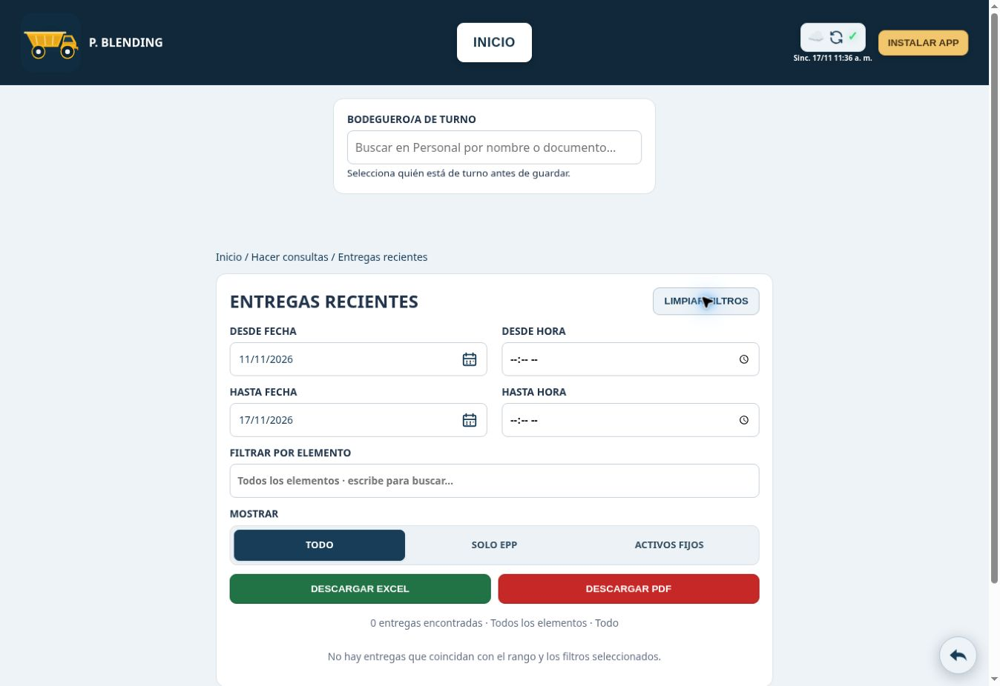

# Calendarios de fecha — 17/11/2026

SK Web Admin, Plaza Blending y Producción comparten `date-calendar.js` y `date-calendar.css`. Todos los campos editables de fecha de formularios y consultas abren el calendario nativo al tocar el campo. La fecha visible usa DD/MM/AAAA, independientemente del idioma del dispositivo. Los campos de fecha y hora conservan ambos valores.

Se mantienen los controles originales, sus nombres, formatos internos, restricciones y eventos. Los campos que antes recibían texto DD/MM/AAAA tienen un selector nativo sin nombre que transmite la selección al control original. Los controles ISO siguen almacenando ISO. La integración detecta también formularios creados después de cargar la página y actualizaciones programáticas de valores, así como reinicios de formulario. Las fechas bloqueadas permanecen bloqueadas.

Los tres service workers precargan los archivos compartidos para uso sin conexión. No requiere modificar Apps Script ni migrar registros.

## Verificación

- 121 pruebas aprobadas: calendario, Producción y registro de actas.
- Selección real en el calendario de Producción: 18/11/2026 visible y en el campo original de texto.
- Selección real en Plaza Blending: 10/11/2026 visible y `2026-11-10` en el filtro original. Limpiar filtros restablece ambos valores.
- Selección real en Admin: 16/11/2026 en el registro de actas. Nueva acta restablece correctamente la fecha actual. El selector conserva la obligatoriedad y no agrega campos con nombre al envío.
- Revisión visual con datos ficticios y solicitudes de escritura interceptadas en la vista local de prueba.
- La suite adicional de consulta de documentos presenta 6 fallos preexistentes; su código y pruebas coinciden byte por byte con la revisión anterior. No carga el nuevo selector.

