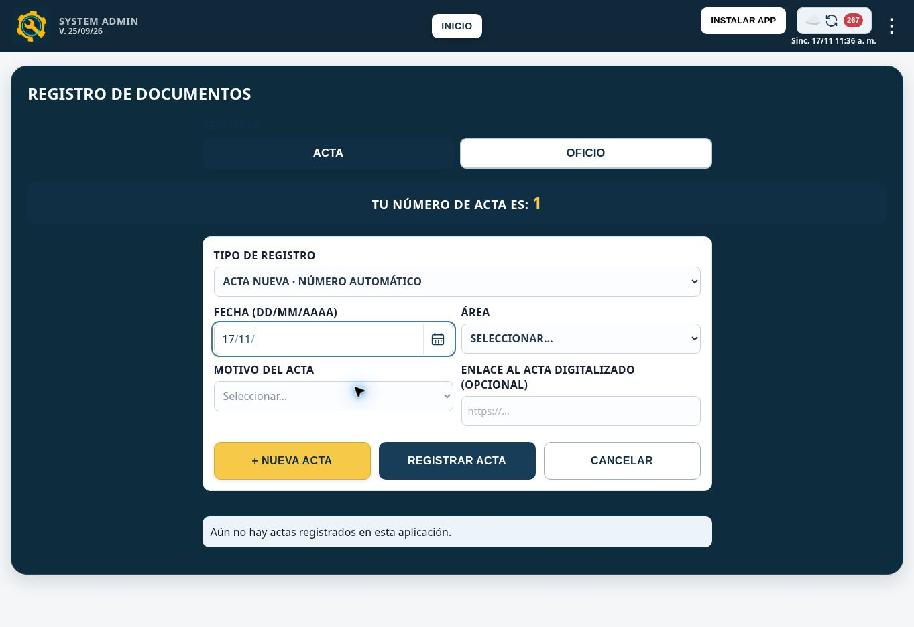

# Fecha por teclado o calendario — 17/11/2026

SK Web Admin, Plaza Blending y Producción comparten `date-calendar.js` y `date-calendar.css`. El campo de fecha permite escribir con teclado numérico y el icono de la derecha abre el calendario nativo. Al escribir el segundo dígito del día y del mes aparecen automáticamente separadores `/` en gris claro: `17/` y `17/11/`. Al presionar Enter o salir del campo, se completa la fecha en DD/MM/AAAA.

- `1711` → `17/11/2026`, usando el año actual de Colombia.
- `17112025` → `17/11/2025`.
- También acepta fechas con barras y fechas ISO pegadas.
- Las fechas imposibles o incompletas muestran un error y bloquean el envío. No se trasladan automáticamente a otro día o mes.
- Los campos con fecha y hora conservan la hora al cambiar la fecha y permiten editarla por separado.

Los controles originales mantienen sus nombres, tipos, valores internos, restricciones y eventos. Los campos de texto conservan DD/MM/AAAA y los nativos conservan ISO. El editor visible y el calendario no tienen nombre, por lo que no agregan valores al envío. Se respetan fechas obligatorias, opcionales, límites y solo lectura. Los reinicios de formulario y asignaciones desde la app actualizan la representación visible; se detectan también formularios creados dinámicamente.

Los tres service workers precargan la versión 3 para uso sin conexión. No requiere modificar Apps Script ni migrar registros.

## Verificación

- 126 pruebas aprobadas: calendario, Producción y registro de actas.
- Guía visual verificada con escritura progresiva, borrado, corrección del mes seleccionado y confirmación con año actual. Las barras son caracteres del campo accesible; la capa visual usa el color gris y se oculta a lectores de pantalla. El modo de alto contraste conserva el texto nativo.
- Pruebas de calendario: formatos existentes, fecha abreviada, año explícito, años bisiestos, fechas incompletas e imposibles, filtros vacíos y ausencia de inversión entre día y mes.
- Pruebas en navegador con datos ficticios: Enter, salida del campo, selector de calendario, error `3111`, límite máximo, limpieza de fecha opcional, restablecimiento y asignación programática.
- FormData conserva únicamente los campos originales y sus formatos; una selección emite un solo cambio. Editar una fecha y hora conserva la hora anterior.
- Producción: `17112025` → `17/11/2025` y `1711` → `17/11/2026`; teclado configurado como numérico.
- Plaza Blending: `1011` → `10/11/2026`, con `2026-11-10` en el filtro original; limpiar filtros restablece ambos valores.
- Admin: `16112025` → `16/11/2025`; nueva acta restablece la fecha actual.
- Sin escrituras en registros reales durante la revisión. No se probó físicamente el teclado de un teléfono.
- La suite adicional de consulta de documentos tiene 6 fallos preexistentes identificados en la revisión anterior; su código no cambia ni carga el nuevo selector.

